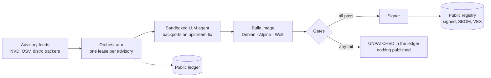
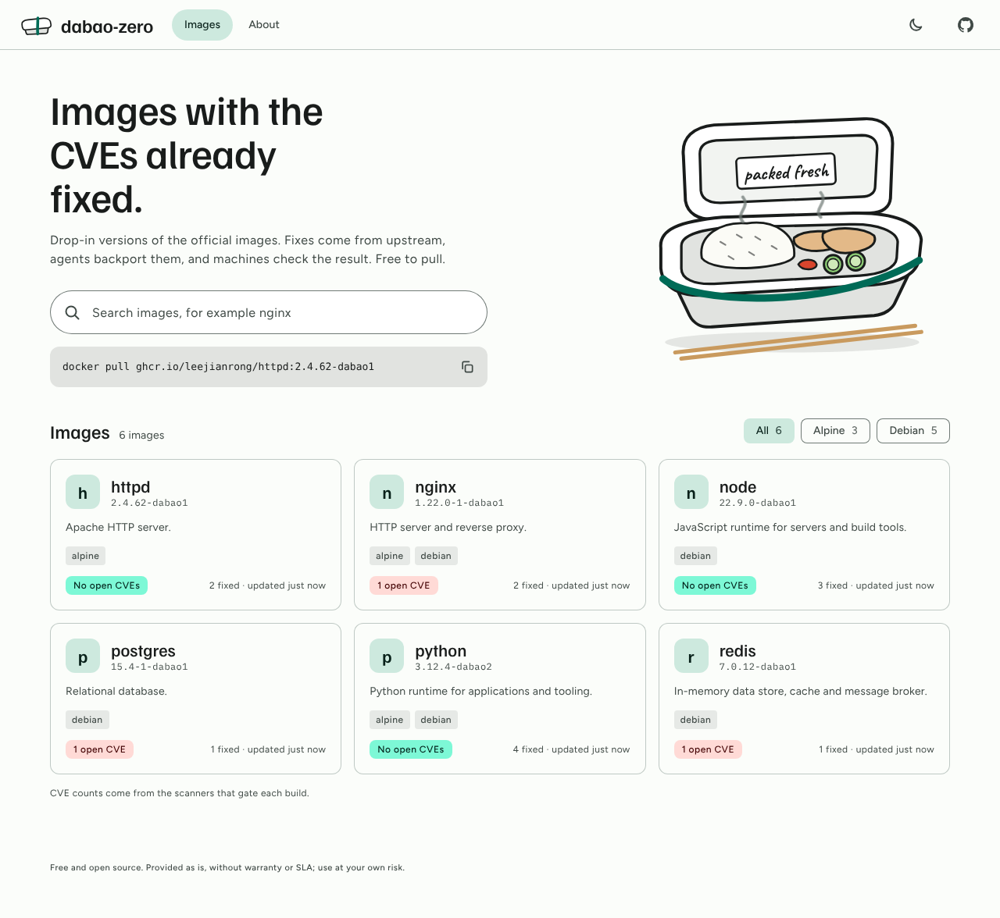
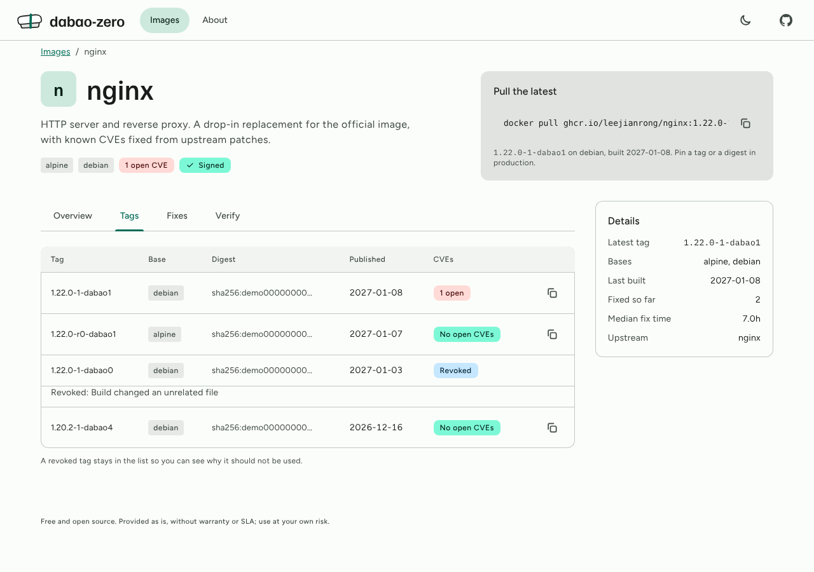

# dabao-zero

Free, open-source container images that behave like the official ones, with their CVEs fixed
by LLM agents and no human maintainer in the patch path.

> **Status: early alpha.** The pipeline pieces exist and are tested, but nothing is wired to a
> live registry yet and **no images are published**. No SLA, no warranty; use at your own risk.

## Why

Chainguard images are paid. Docker's free Hardened Images are hardened by stripping functionality
out, so they are not drop-in. dabao aims for the opposite trade: the same image you already run,
with known CVEs fixed by backporting the upstream fix, checked by deterministic gates before
anything is signed and published. Every patch's diff and agent run is public.



The agent only proposes. Deterministic code decides: both scanners must clear the CVE, the
official image's test suite must pass, the build may change only what the patch touches, and the
patch must derive from an upstream fix the agent actually fetched
([ADR-0002](docs/adr/0002-automated-publish-with-machine-checkable-gates.md),
[ADR-0003](docs/adr/0003-two-patch-streams-upstream-derived-now.md)).

## What exists today

| Built and tested | Not built yet |
|------------------|---------------|
| Publish gates with a known-good/known-bad corpus | Debian, Alpine and Wolfi build adapters |
| Orchestrator: leases, cost caps, no partial publish | Sandboxed agent tool box |
| Guarded signer (refuses ungated, revoked or frozen) | Real cosign signing and registry publishing |
| Ledger database, migrations, public `/v1` API | Live advisory fetchers (NVD, OSV, Debian tracker) |
| Ledger web UI (Svelte) | Alpine and Wolfi advisory handling |
| OpenAI-compatible agent client (OpenRouter) | A live end-to-end run |
| Advisory parsing and ingestion (fixture-tested) | |
| Operator CLI: freeze, revoke, rerun, status | |
| Package inventory from OCI images via `regctl` | |

## Quick start: run the ledger locally with fake demo data

Needs [uv](https://docs.astral.sh/uv/) and Node 22. Advisory ids in the demo are `DEMO-*`;
nothing here is a real vulnerability.

```bash
git clone https://github.com/leejianrong/dabao-zero && cd dabao-zero
make sync        # backend dependencies
make demo        # seeds ./dabao.db, starts the API, prints its URL (first free port from 8000)
```

In a second terminal, using the port the first one printed:

```bash
cd frontend && npm ci
DABAO_API=http://127.0.0.1:8000 npm run dev    # open the URL Vite prints
```





## Usage

The ledger API is public and read-only:

```bash
curl localhost:8000/v1/images                  # per-image counts and median time to patch
curl 'localhost:8000/v1/advisories?status=UNPATCHED'
curl localhost:8000/v1/advisories/DEMO-0001    # attempts, cost and the patch diff
```

An operator can revoke a published artifact (the endpoint answers `503` until a token is set):

```bash
export DABAO_OPERATOR_TOKEN=change-me          # set before starting the API
curl -X POST localhost:8000/v1/artifacts/<digest>/revoke \
  -H "Authorization: Bearer $DABAO_OPERATOR_TOKEN" \
  -H 'Content-Type: application/json' -d '{"reason": "bad build"}'
```

Operator commands (talk to the database in `$DATABASE_URL`):

```bash
uv run dabao status                              # frozen? counts per status
uv run dabao freeze --note "investigating"       # stop new attempts and all signing
uv run dabao rerun DEMO-0003                     # re-queue a failed advisory
```

Run the tests: `make check` (lint, types, unit; no Docker or network needed).

## Configuration

| Variable | Default | Purpose |
|----------|---------|---------|
| `DATABASE_URL` | `sqlite+pysqlite:///./dabao.db` | Ledger database (Postgres in production) |
| `DABAO_OPERATOR_TOKEN` | unset | Enables operator actions; unset means they are disabled |
| `DABAO_CORS_ORIGINS` | none | Comma-separated origins allowed to call the API from a browser |
| `LLM_API_KEY`, `LLM_MODEL` | none | Required for live agent runs |
| `LLM_BASE_URL` | `https://openrouter.ai/api/v1` | Any OpenAI-compatible endpoint |

## Learn more

[`PLAN.md`](PLAN.md) (what and why) · [`docs/adr/`](docs/adr/) (decisions) ·
[`SLICES.md`](SLICES.md) (build order) · [`TASKS.md`](TASKS.md) (backlog) ·
[`docs/testing-and-ci.md`](docs/testing-and-ci.md)

## Contributing and security

See [`CONTRIBUTING.md`](CONTRIBUTING.md). Report vulnerabilities privately as described in
[`SECURITY.md`](SECURITY.md). Questions and bugs: open an issue.

## License

[Apache-2.0](LICENSE). Each published image will carry its upstream software's own licences.
